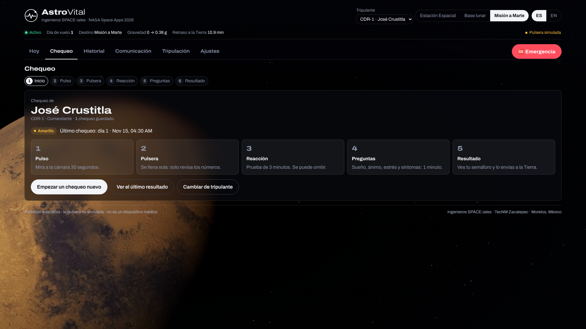
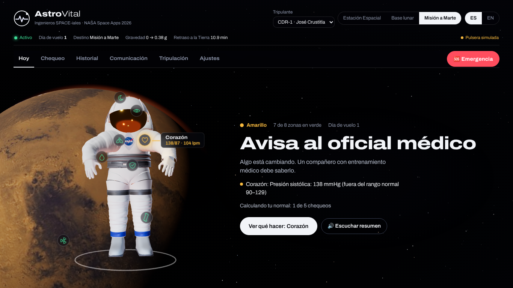
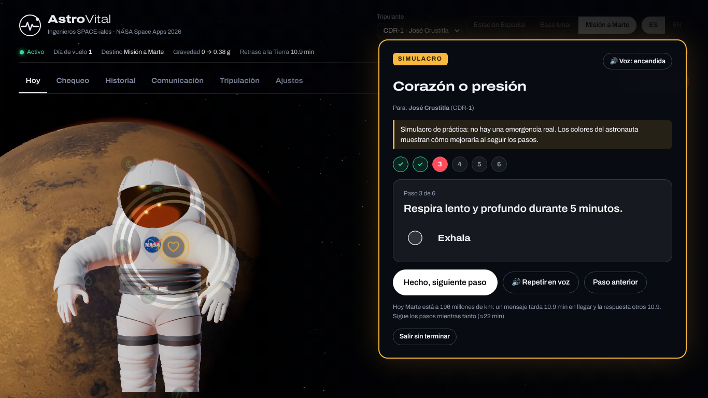
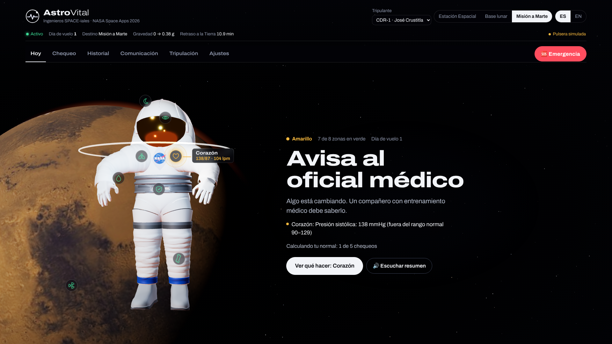
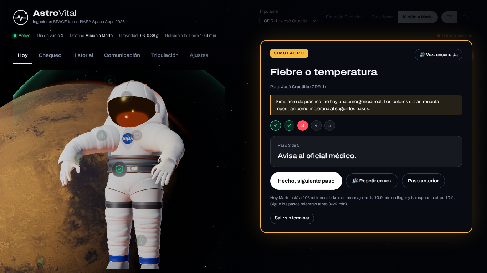
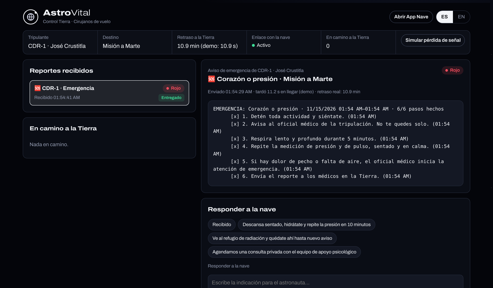

# AstroVital: Astronaut Health Monitoring


**Team:** Ingenieros SPACE-iales · TecNM Zacatepec, Morelos, Mexico
**Challenge:** NASA Space Apps Challenge 2026 · *Create Health Monitoring Software for Astronauts on Space Missions*

## The problem
On long missions astronauts face NASA's five hazards of human spaceflight. Far from Earth a message to Mars takes 3 to 22 minutes each way, so the crew must notice health changes and act on their own while Earth answers.

## Our solution
AstroVital runs entirely in the browser, offline-first, with no server:

- **Ship app (`index.html`)**, used by the crew on the spacecraft computer.
  - **Guided check-up**, one screen at a time: start (whose check-up, how many are saved, the last result) → pulse with the camera → wristband → reaction test → questions → result → send to Earth. Every saved check-up can be opened in History to see everything that was measured.
  - **Real pulse from the webcam** (remote photoplethysmography, POS method, Wang et al. 2017).
  - **Reaction test PVT-B** (Basner et al. 2011), mood and stress scales (0–100) and the weekly PSS-4 questionnaire, which the app can read aloud.
  - **The astronaut is the body map**: NASA's own 3D model of the EMU spacesuit (white, gold mirror visor, arms down, with the AstroVital logo and name plate instead of NASA marks) floats and turns slowly over the planet of the mission. Each of the 8 body zones is pinned to the suit and lights up green, yellow or red; affected zones cast a glow on that part of the suit and show their value, and choosing one flies the camera to it and opens what to do.
  - **Emergencies you can see**: every emergency guide docks to the right while the camera goes to the affected part of the astronaut.
    - Solar storm: particle streaks cross the screen and the suit glows orange while exposed; a refuge shield rises when the crew reaches the shelter.
    - Heart or blood pressure: the chest pulses with the heartbeat, with a breathing pacer (4 s in, 6 s out) on the breathing step.
    - Low oxygen: the chest breathes with the pacer and oxygen flows to the helmet on the supplemental-oxygen step.
    - Fever: the suit runs warm and an isolation bubble appears when the astronaut isolates.
    - Any of them can be run as a **drill** from the emergency button. In a drill the color goes from red to green as steps are done; in a real emergency the color always follows the real data.
  - **Spoken summary**: one button reads the status, the reason and the next step aloud. It runs on the computer, with no AI service and no internet.
  - **Living background**: a real planet turns behind the whole app, drawn from NASA imagery: the Earth with its city lights for the Station, the Moon, or Mars.
  - **Emergency button**, always on screen: step-by-step protocols read aloud (solar storm, heart or blood pressure, low oxygen, fever). A red zone opens the protocol by itself. Every step done is logged and reported to Earth.
  - **Live space weather**: NOAA GOES proton flux classified with NOAA's S-scale, and NASA DONKI solar flares. A strong storm (S3+) opens the storm protocol.
  - **Virtual dosimeter**: estimated dose from the published daily dose of each destination and NASA's 600 mSv career limit.
  - **Personal normal**: the first 5 check-ups of each astronaut define their normal; later check-ups are compared with it ("pulse 12 above your normal").
- **Earth Control app (`tierra.html`)**, used by flight surgeons: receives reports and emergency notices and answers the astronaut who sent them.
- **Delay-tolerant link**: messages are stored and forwarded like NASA's DTN. With no signal they wait in a queue and leave by themselves when it returns. The Mars delay is the real light time for today's Earth–Mars distance, computed from JPL orbital elements.
- **On-board database**: IndexedDB, one separate history per astronaut. Backup to a file to move data between computers.

English and Spanish. The interface needs no internet: the typeface (Archivo, SIL Open Font License), three.js, the 3D model and the planet images are bundled. If a computer cannot draw 3D (no WebGL), the app falls back by itself to a drawn astronaut and a still background.

## What is real and what is simulated
- **Nothing is preloaded.** The app starts empty: no sample astronauts, no sample check-ups.
- **Real:** camera pulse, reaction test, questionnaires, NOAA and NASA data, Earth–Mars distance.
- **Simulated (always labeled "Simulado"):** the virtual wristband (blood pressure, oxygen, temperature, glucose, exercise). On a spacecraft a sensor wristband would provide these. Values can also be typed by hand from real devices.
- **Estimated (labeled):** the radiation dose. The app has no physical dosimeter.
- With no internet, space weather says "no data yet" and never invents a storm. The storm drill uses the real event of 10 May 2024 and is labeled as a drill.

It is an educational prototype, not a medical device.

## NASA and partner data and tools
| What | Source |
| --- | --- |
| Proton flux ≥10 MeV, live | NOAA SWPC, GOES satellite JSON feed |
| Solar flares, last 7 days | NASA DONKI (CCMC) through api.nasa.gov |
| Solar radiation storm scale S1–S5 | NOAA Space Weather Scales |
| Earth–Mars distance and light time | NASA/JPL "Approximate Positions of the Planets", Table 1 |
| Career dose limit, 600 mSv | NASA-STD-3001 |
| Daily dose: ISS, lunar surface, Mars cruise | NASA (ISS 0.2–0.5 mSv/day), Chang'e 4 (Zhang et al. 2020), Curiosity RAD (Zeitlin et al. 2013) |
| Storm drill | NOAA SWPC report, 10 May 2024 (206 pfu); NASA/JPL Curiosity RAD, 20 May 2024 (8,100 µGy) |
| Hazards, risks and body zones | NASA Human Research Program |
| 3D spacesuit model, Mars map | NASA 3D Resources (github.com/nasa/NASA-3D-Resources) |
| Earth by day and city lights at night | NASA Blue Marble and Earth at Night imagery (see `assets/space/CREDITS.md`) |
| Store-and-forward link | NASA Delay/Disruption Tolerant Networking (concept) |

## How to run it
Browsers block JavaScript modules opened by double click, so use a local server:

1. Open the folder in VS Code and start **Live Server** on `index.html`, or
2. run `python -m http.server` in the folder and open `http://localhost:8000`, or
3. publish the folder with GitHub Pages.

Open `tierra.html` in a second tab of the same browser to play Earth Control. Allow the camera when the browser asks. Use a computer (laptop or desktop).

## Tests
Open `tests/index.html`: 58 automated tests of the real models (ranges, evaluator, dosimeter, space weather, Mars distance, personal normal, emergencies, database, crew separation, camera pulse algorithm, reaction test, backup and link). Test histories live only in `tests/fixtures.js`; the app never loads them.

## Structure (MVC)
```
index.html · tierra.html        the two apps
js/config/                      texts, ranges, zones, missions, emergency protocols
js/models/                      data and rules (no screen code)
js/views/nave · js/views/tierra what is drawn on screen
js/controllers/                 connect models and views
js/utils/                       charts, formatting, voice
js/space/                       3D: rotating planet background and NASA astronaut (three.js)
js/vendor/                      three.js (MIT)
assets/                         typeface, 3D model, planet images (with credits)
css/                            styles
tests/                          automated tests
docs/                           architecture notes and screenshots
```

## Screenshots
| Check-up start screen | Today: NASA's spacesuit is the body map |
| --- | --- |
|  |  |
| **Heart drill with breathing pacer** | **Today on a large monitor** |
|  |  |
| **Fever drill: isolation bubble** | **Earth Control** |
|  |  |
