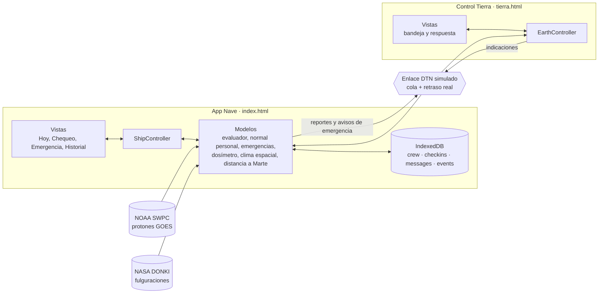

# AstroVital · Arquitectura (resumen)

Todo corre en el navegador de la computadora de la nave. No hay servidor: la nave tiene que funcionar sola.

## Modelos (js/models)
| Archivo | Qué hace |
| --- | --- |
| `Database.js` | Base de datos a bordo (IndexedDB), con respaldo en memoria |
| `CrewModel.js` | Astronautas. La app empieza sin ninguno |
| `CheckinModel.js` | Chequeos de cada astronauta, separados por `crewId` |
| `CameraPulse.js`, `RppgPOS.js` | Pulso real con la cámara (método POS) |
| `MindModel.js` | Prueba de reacción PVT-B, escalas 0–100 y PSS-4 |
| `SensorSimulator.js` | Pulsera virtual: lo único simulado |
| `HealthEvaluator.js` | Semáforo de las 8 zonas y tendencias |
| `BaselineModel.js` | Normal personal: promedio de los primeros 5 chequeos |
| `EmergencyModel.js` | Protocolos paso a paso y registro de lo que se hizo |
| `SpaceWeather.js` | NOAA y NASA DONKI en vivo, escala S |
| `RadiationModel.js` | Dosímetro virtual (estimación) |
| `Ephemeris.js`, `DelayModel.js` | Distancia real Tierra–Marte (tabla de JPL) y retraso de los mensajes |
| `LinkModel.js` | Enlace con la Tierra: guardar y reenviar |
| `ReportBuilder.js` | Reporte para los médicos |
| `DataModel.js` | Respaldo y borrado |

## Fondo espacial y astronauta 3D (js/space)
| Archivo | Qué hace |
| --- | --- |
| `SpaceBackdrop.js` | Fondo de toda la app: el planeta de la misión girando (Tierra con luces nocturnas, Luna o Marte), atmósfera y estrellas, con WebGL (three.js) |
| `StormFx.js` | Tormenta de radiación: partículas que cruzan la escena y el escudo del refugio |
| `Astronaut3D.js` | Modelo 3D del traje espacial EMU de NASA (con el logo de AstroVital) flotando; guías animadas de emergencia (tormenta, corazón, oxígeno, fiebre); las zonas del cuerpo son puntos 3D sobre el traje y las zonas afectadas lo iluminan en amarillo o rojo |
| `views/nave/AstronautStage.js` | Une el 3D con la app; si no hay WebGL usa el astronauta dibujado (`AstronautView.js`) |

Las fuentes de imágenes y modelo están en `assets/space/CREDITS.md`.

## Reglas definidas por el equipo (no vienen de un estudio)
- Estrés ≥ 70/100 o 3 lapsos o más en la prueba oficial de reacción ponen "Mente y sueño" en amarillo.
- Tormenta S1–S2 = amarillo; S3 o más = rojo (NOAA recomienda protegerse a partir de S3).
- "Fuera de tu normal": pulso ±10, sistólica ±10, diastólica ±8, temperatura ±0.5 °C, glucosa ±15, oxígeno −2, sueño −1 h. Solo agrega una nota; no cambia el semáforo.
- Las tendencias necesitan 7 días de datos y los promedios 3 días.
- Los protocolos de emergencia son educativos, escritos por el equipo a partir de fuentes de NASA y NOAA.
- La traducción al español del PSS-4 es del equipo.
- En la demo, 1 minuto real de retraso a Marte se muestra como 1 segundo.
